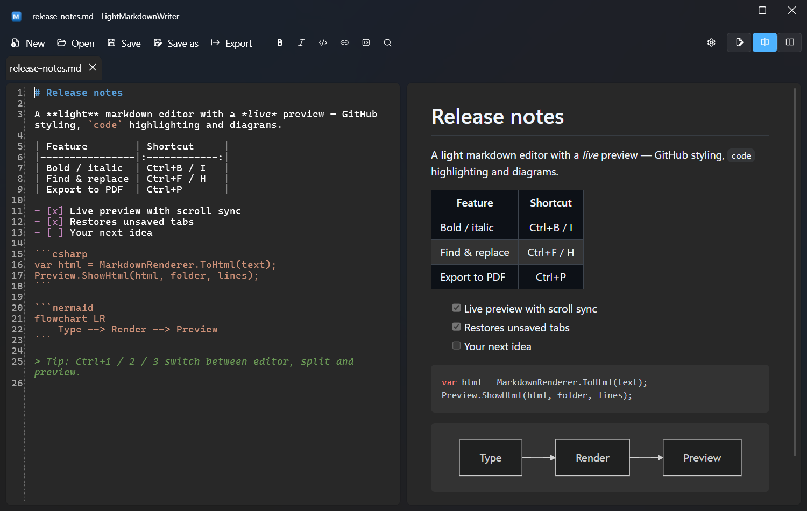

# LightMarkdownWriter

A light, fast markdown editor for Windows 11 with a live, GitHub-style preview.



## Features

- **Live preview** in GitHub style (light/dark):
  - GFM tables, task lists, footnotes and strikethrough
  - highlight.js code highlighting and Mermaid diagrams
  - everything bundled, so it works offline
- **Two-way scroll sync** between editor and preview. It follows source lines, so tall images and diagrams don't make the panes drift apart.
- **Split, editor-only or preview-only** views.
- **Tabs that survive restarts.** Closing never asks to save: every tab, its unsaved text, caret and scroll position come back next time.
- **Edits from other programs are detected.** A clean tab reloads in place; a tab with unsaved edits asks you what to do.
- **Editing helpers:**
  - markdown syntax colours
  - bold/italic/code/link/code-block shortcuts
  - lists continue on Enter
  - find & replace with regex
- **Export** as a standalone HTML file or a PDF, or **copy as HTML** that pastes cleanly into Outlook, Word or Teams. Exports are always light-themed.
- **Windows 11 look:** Mica, Fluent controls, and your Windows light/dark theme and accent colour.
- **One small exe.** A single portable file, one window, and a second launch opens its files in the running window.

## Requirements

- Windows 10 1809 or later. Built and tested on Windows 11.
- [.NET 10 Desktop Runtime](https://dotnet.microsoft.com/download/dotnet/10.0).
- Microsoft Edge WebView2 Runtime, which comes with Windows 11.

## Keyboard shortcuts

| Action | Shortcut |
|---|---|
| New / Open / Save / Save as | Ctrl+N / Ctrl+O / Ctrl+S / Ctrl+Shift+S |
| Close tab | Ctrl+W or middle-click the tab |
| Next / previous tab | Ctrl+Tab / Ctrl+Shift+Tab |
| Editor / Split / Preview | Ctrl+1 / Ctrl+2 / Ctrl+3 |
| Bold / Italic / Inline code | Ctrl+B / Ctrl+I / Ctrl+E |
| Link / Code block | Ctrl+K / Ctrl+Shift+K |
| Find / Replace | Ctrl+F / Ctrl+H |
| Next / previous match | F3 / Shift+F3 (Enter / Shift+Enter in the find box) |
| Match case / whole word / regex | Alt+C / Alt+W / Alt+R (in the find box) |
| Replace all | Ctrl+Alt+Enter (in the replace box) |
| Export HTML / Export PDF / Copy as HTML | Ctrl+Shift+E / Ctrl+P / Ctrl+Shift+C |
| Settings | Ctrl+, |

## Opening .md files with it

Go to **Settings (Ctrl+,) → Files → Register**. This adds LightMarkdownWriter to *Open with* for `.md` and `.markdown` files. It only touches your user account (HKCU) and needs no admin rights. If you move the exe, register again.

Windows 11 lets only you choose default apps. To make it the default, use **Open Default apps** on the same page and pick LightMarkdownWriter for `.md`.

## Build

```powershell
dotnet build
dotnet test
```

Run it with `dotnet run --project src/LightMarkdownWriter`, optionally passing files to open. `--theme=light` or `--theme=dark` overrides the theme setting for that run.

### Publish a portable exe

```powershell
dotnet publish src/LightMarkdownWriter -p:PublishProfile=win-x64
```

This produces a single `artifacts/publish/LightMarkdownWriter.exe` of about 15 MB. It's framework-dependent and ReadyToRun-compiled, with the preview page, libraries and WebView2 loader embedded. Copy it anywhere and run it.

## Where things are stored

Everything lives in `%LOCALAPPDATA%\LightMarkdownWriter\`:

| Path | Contents |
|---|---|
| `settings.json` | Theme, font, font size, word wrap, line numbers |
| `session.json` | Open tabs, caret/scroll positions, window placement, view mode |
| `backups\` | Unsaved text of open tabs; removed once a tab is saved or closed |
| `WebView2\` | The preview's browser cache |

To reset the app, delete the folder while the app is closed.

## How it's built

- **WPF on .NET 10** with [WPF-UI](https://github.com/lepoco/wpfui) for the Windows 11 look.
- **[AvalonEdit](https://github.com/icsharpcode/AvalonEdit)** for the editor.
- **[Markdig](https://github.com/xoofx/markdig)** renders the markdown. Every block carries its source line, which is what drives scroll sync.
- **WebView2** shows the preview:
  - [github-markdown-css](https://github.com/sindresorhus/github-markdown-css), [highlight.js](https://highlightjs.org/) and [Mermaid](https://mermaid.js.org/) are embedded in the exe.
  - The preview page's Content-Security-Policy blocks scripts that come from markdown content.

[PLAN.md](PLAN.md) has the design notes and the reasons behind the less obvious choices.

## License

[MIT](LICENSE)
